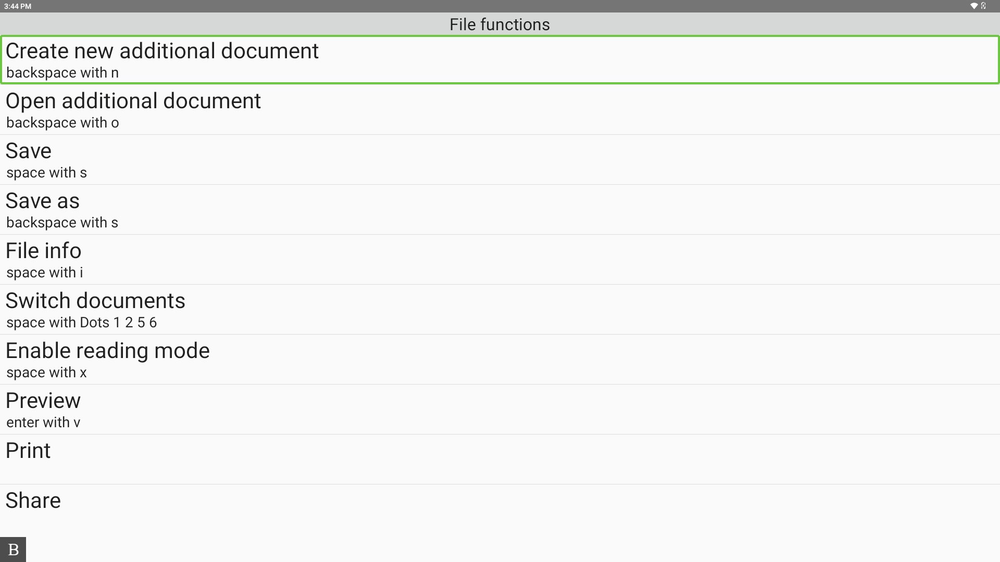

# Contextual menu

A contextual menu is a view that shows the list of commands available for the current state of an app.

## Overview

In daily use, it helps users quickly find and execute actions without leaving their workflow. You can think of it like the ribbon in Microsoft Word: it surfaces relevant commands and their shortcuts in one place.

The contextual menu lists the actions available in the current screen, along with their associated shortcuts. This is especially useful when a user forgets how to trigger a specific command and needs a quick reminder without opening extra documentation.

When a menu item is selected, the linked action is executed.

*Example of the context menu in KeyWord*

See [SelfBraillingContextMenuActivity.kt](../../app/src/main/java/com/humanware/keysoftsdkdemoapp/ui/SelfBraillingContextMenuActivity.kt) for the demo implementation.

## Related references

- **Learn it:** [Example](../examples/context-menu.md)
- **See it in code:** [SelfBraillingContextMenuActivity.kt](../../app/src/main/java/com/humanware/keysoftsdkdemoapp/ui/SelfBraillingContextMenuActivity.kt)
