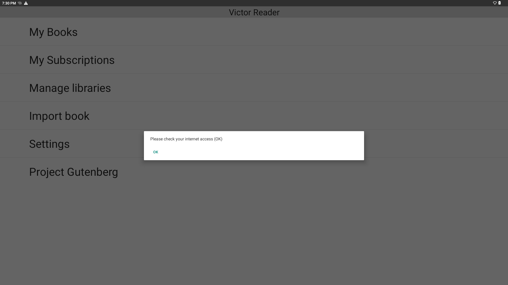
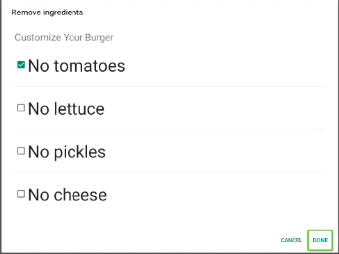

# Dialogs

Dialogs are temporary UI views used to communicate important information, request confirmation, or show task progress without navigating away from the current activity.

## Overview


*Example of an OK dialog asking for user input when there is no internet connection in VictorReader*

In daily use, dialogs help users stay focused: they get the message or decision point immediately, act on it, and continue their workflow. 
Dialogs help create a dynamic and interactive workflow when user input is needed.

## See various dialog samples

The following dialog types are showcased in this demo app:

| Dialog           | Description                                                                     |
|------------------|---------------------------------------------------------------------------------|
| Simple dialog    | Basic dialog displayed to the user until they choose to close it.               |
| Loading dialog   | Displays a message prompting the user to wait for a task to be done.            |
| Progress dialog  | Displays a progress bar with a live percentage of completion        |
| OK dialog        | Displays a message until the user presses the only option available.            |
| OK/Cancel dialog | Displays a message until the user presses either a positive or negative option. |

> **Accessibility recommendation:** The usage of the progress dialog is not recommended.
>
> To read the progress percentage, users need to move focus to the percentage field.
> Also, depending on the Braille display used, refresh will not occur while a finger remains on the Braille cells. Because this UI updates dynamically, that limitation can make the dialog ineffective in practice.

See [DialogSampleActivity](../../app/src/main/java/com/humanware/keysoftsdkdemoapp/ui/DialogSampleActivity.kt) for an example implementation.
For a standard checkable-list workflow, see [dialogs.md](../tutorials/dialogs.md#simple-workflow---example-with-checkboxes).

## Advanced custom dialogs

Beyond the standard dialog helpers, you can also create more advanced dialogs by inflating a custom layout and wiring your own interaction model. This pattern is useful when a dialog needs richer content and behavior than a simple message or confirmation prompt. [See more details](../examples/dialogs.md#advanced-custom-dialogs).

For new custom dialogs, prefer [AccessibleDialog](#accessibledialog), the recommended approach.



*Example of the dialog in KeySoftSDKDemo in [CheckListActivity.kt](../../app/src/main/java/com/humanware/keysoftsdkdemoapp/ui/CheckListActivity.kt)*

## AccessibleDialog

`AccessibleDialog` is the dialog counterpart of [AccessibleActivity](./menu.md#accessibleactivity): it makes any layout navigable with first letter navigation and the Home and End keys, and follows the same [rules](../tutorials/accessible-activity-menu.md#rules).

> **Recommendation:** `AccessibleDialog` is the new approach to building accessible dialogs, and it is the recommended way to create a dialog with your own layout.
>
> With the [advanced custom dialog](#advanced-custom-dialogs) approach, the dialog content has to be an `AccessibleListView` filled with `AccessibleItem`s. `AccessibleDialog` works on the same layout you would write for any Android dialog, so you keep standard views and view binding while still providing the navigation KeySoft users expect. Dialogs built the older way still work.

The differences with `AccessibleActivity` are:

- The content view is set when the dialog is first shown. Look up views in your subclass's `onCreate` after calling `super`, using the `rootView` property to bind to, or after `show()` when you use the class as is.
- The navigation is attached in `onStart` and detached in `onStop`, the dialog equivalent of `onResume` and `onPause`.
- The third constructor argument, `fullScreen`, chooses between a dialog floating over the current screen (`false`, the default) and one covering it (`true`). Pass it positionally: named arguments are not available on this constructor from Kotlin.

```kotlin
class EditNameDialog(
    context: Context,
    private val onSave: (String) -> Unit
) : AccessibleDialog(context, R.layout.dialog_edit_name) {

    private lateinit var binding: DialogEditNameBinding

    override fun onCreate(savedInstanceState: Bundle?) {
        super.onCreate(savedInstanceState)
        binding = DialogEditNameBinding.bind(rootView)

        binding.saveButton.setOnClickListener {
            onSave(binding.nameInput.text.toString())
            dismiss()
        }
    }
}
```

`AccessibleDialog` requires KeySoftSDK 0.1.169 or later.

## Related references

- **Learn it:** [Example](../examples/dialogs.md), [Tutorial](../tutorials/dialogs.md)
- **See it in code:** 
  - [DialogSampleActivity.kt](../../app/src/main/java/com/humanware/keysoftsdkdemoapp/ui/DialogSampleActivity.kt) shows the standard dialog helpers.
  - [EditNameDialog.kt](../../app/src/main/java/com/humanware/keysoftsdkdemoapp/ui/EditNameDialog.kt) shows how to subclass `AccessibleDialog` and bind its views.
  - [AccessibleSampleActivity.kt](../../app/src/main/java/com/humanware/keysoftsdkdemoapp/ui/AccessibleSampleActivity.kt) opens a floating `AccessibleDialog` and a full screen one used without a subclass.
- **Related concept:** [menu.md](./menu.md#accessibleactivity)
