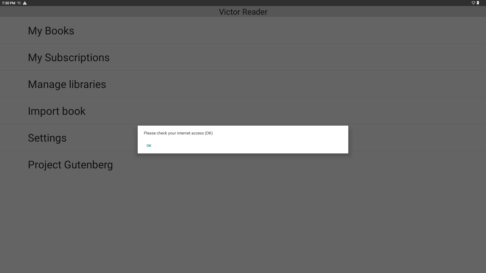
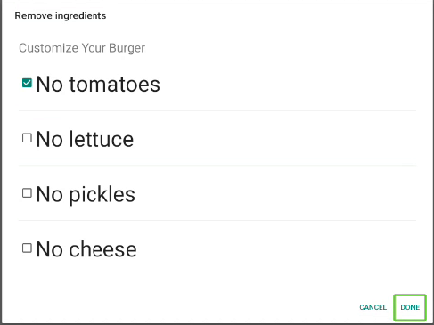

# Dialogs

Dialogs are temporary UI views used to communicate important information, request confirmation, or show task progress without navigating away from the current activity.

## Overview

*Example of an OK dialog asking for user input when there is no internet connection in VictorReader*

In daily use, dialogs help users stay focused: they get the message or decision point immediately, act on it, and continue their workflow. 
Dialogs help create a dynamic and interactive workflow when user input is needed.

## See various dialog samples

The following dialog types are showcased in this demo app:

| Dialog           | Description                                                                     |
|------------------|---------------------------------------------------------------------------------|
| Simple dialog    | Basic dialog displayed to the user until they choose to close it.               |
| Loading dialog   | Displays a message prompting the user to wait for a task to be done.            |
| Progress dialog  | Displays a progress bar with a live percentage of completion        |
| OK dialog        | Displays a message until the user presses the only option available.            |
| OK/Cancel dialog | Displays a message until the user presses either a positive or negative option. |

> **Accessibility recommendation:** The usage of the progress dialog is not recommended.
>
> To read the progress percentage, users need to move focus to the percentage field.
> Also, depending on the Braille display used, refresh will not occur while a finger remains on the Braille cells. Because this UI updates dynamically, that limitation can make the dialog ineffective in practice.

See [DialogSampleActivity](../../app/src/main/java/com/humanware/keysoftsdkdemoapp/ui/DialogSampleActivity.kt) for an example implementation.
For a standard checkable-list workflow, see [dialogs.md](../tutorials/dialogs.md#simple-workflow---example-with-checkboxes).

## Advanced custom dialogs

Beyond the standard dialog helpers, you can also create more advanced dialogs by inflating a custom layout and wiring your own interaction model. This pattern is useful when a dialog needs richer content and behavior than a simple message or confirmation prompt. [See more details](../examples/dialogs.md#advanced-custom-dialogs).

*Example of the dialog in KeySoftSDKDemo in [CheckListActivity.kt](../../app/src/main/java/com/humanware/keysoftsdkdemoapp/ui/CheckListActivity.kt)*

## Related references

- **Learn it:** [Example](../examples/dialogs.md), [Tutorial](../tutorials/dialogs.md)
- **See it in code:** [DialogSampleActivity.kt](../../app/src/main/java/com/humanware/keysoftsdkdemoapp/ui/DialogSampleActivity.kt)
