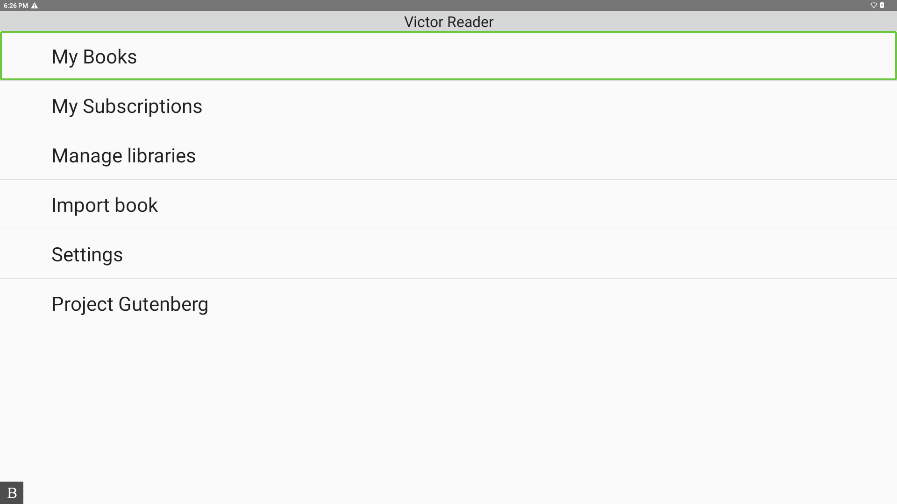

# Menu

The menu package in the SDK provides reusable building blocks for creating accessible, keyboard-first menu screens.

## Overview

*Example of the AccessibleListView in VictorReader*

## Technical

At a high level, the `ui.menu` package is used to build menu activities and list navigation behavior:

- `AccessibleActivity` makes any layout navigable with the KeySoft keys, with no list involved. See [AccessibleActivity](#accessibleactivity). Its dialog counterpart, `AccessibleDialog`, is described in [dialogs.md](./dialogs.md#accessibledialog).
- `AbstractMenuActivity` is the base activity for menus made of accessible items.
- `AccessibleListView` and `AccessibleListViewActivity` provide list behavior for menu entries.
- `FirstLetterNavigationController` supports first-letter navigation in long lists.
- `MultipleChoiceMenuActivity` and `SimpleAccessibleListViewActivity` provide ready-to-use menu activity variants.
- `StableArrayAdapter` supports mixed menu row types (single text, double text, checkable rows).

The `ui.menu.accessibleitem` package contains item types you place in those menus:

- Base item models (`AccessibleItem`, `AccessibleDisabledItem`, `TwoTextViewItem`, `GenericAccessibleItem`).
- Action/result contracts (`IActionItem`, `IResultItem`) and intent-based items (`IntentItem`, `ResultIntentItem`).
- Preference-backed items (`PreferenceItem`, `PreferenceIntegerItem`, `PreferenceIntentItem`).
- Editable and multi-value items (`EditableValueDialog`, `EditableTextDialogItem`, `EditableIntegerDialogItem`, `MultipleValuesItem`).
- Multi-value data access contracts/implementations (`MultipleValuesItem.DataAccess`, `MultipleValuesItem.IntResourceAccess`, `MultipleValuesItem.StringArrayAccess`, `MultipleValuesItem.StringResourceAccess`) used to read and present selectable value sources.

The `ui.menu.accessibleitem.attributes` package defines attribute objects used to configure item rendering and behavior (`AccessibleItemAttributes`, `CheckableAccessibleItemAttributes`, `ButtonAccessibleItemAttributes`, `TwoTextViewsAccessibleItemAttributes`).

## AccessibleActivity

`AccessibleActivity` is a base activity for screens built from an ordinary Android layout: text, buttons, checkboxes, edit fields and nested layouts. You give it a layout and it adds the KeySoft navigation on top of it:

- [First Letter Navigation (FLN)](../glossary.md#first-letter-navigation-fln): typing a letter moves the focus to the next item whose label starts with that letter.
- Home and End move the focus to the first and last item of the screen.

> **Recommendation:** `AccessibleActivity` is the new approach to building accessible screens, and it is the recommended starting point for new ones.
>
> With `AbstractMenuActivity`, the content has to be modelled as a list of `AccessibleItem`s. `AccessibleActivity` works on the same layout you would write for any Android screen, so you keep standard views and view binding while still providing the navigation KeySoft users expect. `AbstractMenuActivity` and `AccessibleListView` still work for existing list-based menus.

To build a screen with it, follow [Building a menu with AccessibleActivity](../tutorials/accessible-activity-menu.md). The tutorial builds this demo's main menu step by step, and covers the theme, what the navigation finds, the rules to follow, and how to migrate a menu from `AbstractMenuActivity`.

## Related references

- **Learn it:** [Building a menu with AccessibleActivity](../tutorials/accessible-activity-menu.md)
- **See it in code:** 
  - [MainMenuActivity.kt](../../app/src/main/java/com/humanware/keysoftsdkdemoapp/ui/MainMenuActivity.kt) shows a menu built with `AccessibleActivity`, the one built in the tutorial.
  - [AccessibleSampleActivity.kt](../../app/src/main/java/com/humanware/keysoftsdkdemoapp/ui/AccessibleSampleActivity.kt) shows a screen built with `AccessibleActivity`, opening a floating and a full screen `AccessibleDialog`.
  - [DialogSampleActivity.kt](../../app/src/main/java/com/humanware/keysoftsdkdemoapp/ui/DialogSampleActivity.kt) and [ImageViewerMenuActivity.kt](../../app/src/main/java/com/humanware/keysoftsdkdemoapp/ui/ImageViewerMenuActivity.kt) show menus built with `AbstractMenuActivity` + `AccessibleListView` + `AccessibleItem`, sorted by label and by position.
  - [SoundAndVibrationActivity.kt](../../app/src/main/java/com/humanware/keysoftsdkdemoapp/ui/SoundAndVibrationActivity.kt) demonstrates an alternative approach to building activities with the new `GenericAccessibleItem` + `AccessibleItemAttributes` + `SimpleAccessibleListViewActivity` classes. 
  - [CheckListActivity.kt](../../app/src/main/java/com/humanware/keysoftsdkdemoapp/ui/CheckListActivity.kt) shows a richer flow combining `GenericAccessibleItem` + `CheckableAccessibleItemAttributes` inside a custom dialog backed by `AccessibleListView`.
- **Related concepts:** [context-menu.md](./context-menu.md), [dialogs.md](./dialogs.md)
