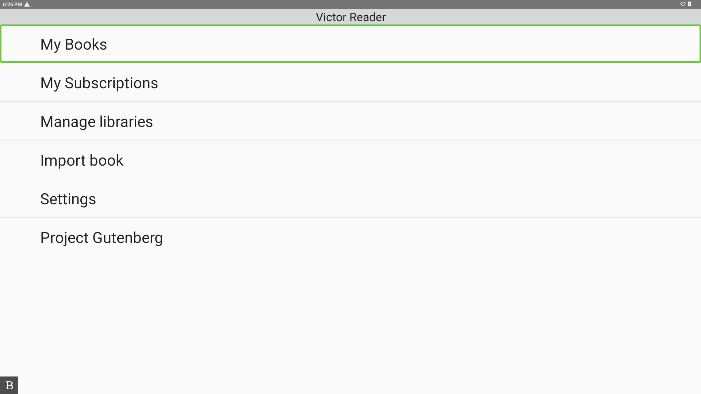

# Menu

The menu package in the SDK provides reusable building blocks for creating accessible, keyboard-first menu screens.

## Overview

*Example of the AccessibleListView in VictorReader*

## Technical

At a high level, the `ui.menu` package is used to build menu activities and list navigation behavior:

- `AbstractMenuActivity` is the base activity for menus made of accessible items.
- `AccessibleListView` and `AccessibleListViewActivity` provide list behavior for menu entries.
- `FirstLetterNavigationController` supports first-letter navigation in long lists.
- `MultipleChoiceMenuActivity` and `SimpleAccessibleListViewActivity` provide ready-to-use menu activity variants.
- `StableArrayAdapter` supports mixed menu row types (single text, double text, checkable rows).

The `ui.menu.accessibleitem` package contains item types you place in those menus:

- Base item models (`AccessibleItem`, `AccessibleDisabledItem`, `TwoTextViewItem`, `GenericAccessibleItem`).
- Action/result contracts (`IActionItem`, `IResultItem`) and intent-based items (`IntentItem`, `ResultIntentItem`).
- Preference-backed items (`PreferenceItem`, `PreferenceIntegerItem`, `PreferenceIntentItem`).
- Editable and multi-value items (`EditableValueDialog`, `EditableTextDialogItem`, `EditableIntegerDialogItem`, `MultipleValuesItem`).
- Multi-value data access contracts/implementations (`MultipleValuesItem.DataAccess`, `MultipleValuesItem.IntResourceAccess`, `MultipleValuesItem.StringArrayAccess`, `MultipleValuesItem.StringResourceAccess`) used to read and present selectable value sources.

The `ui.menu.accessibleitem.attributes` package defines attribute objects used to configure item rendering and behavior (`AccessibleItemAttributes`, `CheckableAccessibleItemAttributes`, `ButtonAccessibleItemAttributes`, `TwoTextViewsAccessibleItemAttributes`).

## Related references

- **See it in code:** 
  - [MainMenuActivity.kt](../../app/src/main/java/com/humanware/keysoftsdkdemoapp/ui/MainMenuActivity.kt) shows a concrete menu built with `AbstractMenuActivity` + `AccessibleListView` + `AccessibleItem`.
  - [SoundAndVibrationActivity.kt](../../app/src/main/java/com/humanware/keysoftsdkdemoapp/ui/SoundAndVibrationActivity.kt) demonstrates an alternative approach to building activities with the new `GenericAccessibleItem` + `AccessibleItemAttributes` + `SimpleAccessibleListViewActivity` classes. 
  - [CheckListActivity.kt](../../app/src/main/java/com/humanware/keysoftsdkdemoapp/ui/CheckListActivity.kt) shows a richer flow combining `GenericAccessibleItem` + `CheckableAccessibleItemAttributes` inside a custom dialog backed by `AccessibleListView`.
- **Related concept:** [context-menu.md](./context-menu.md)
